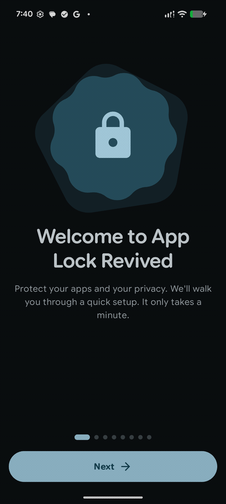

<div align="center">
  
</div>

<h1 align="center">App Lock Revived</h1>
<p align="center"><b>Open-source Android app locker, rebuilt with Material 3 Expressive</b></p>
<p align="center">A fork of <a href="https://github.com/aload0/AppLock">aload0/AppLock</a> by Pranav Purwar</p>

<p align="center">
  <a href="https://opensource.org/licenses/MIT">
    
  </a>
  <a href="https://github.com/riyadmondol2006/AppLock-Revived/releases/latest">
    
  </a>
  <a href="https://github.com/riyadmondol2006/AppLock-Revived/actions/workflows/android.yml">
    
  </a>
  
</p>

## Screenshots

<table align="center">
  <tr>
    <td align="center"><br/><sub><b>Home</b></sub></td>
    <td align="center"><br/><sub><b>Lock screen</b></sub></td>
    <td align="center"><br/><sub><b>Settings</b></sub></td>
    <td align="center"><br/><sub><b>Create a PIN</b></sub></td>
  </tr>
  <tr>
    <td align="center"><br/><sub><b>Unlock history</b></sub></td>
    <td align="center"><br/><sub><b>About</b></sub></td>
    <td align="center"><br/><sub><b>Welcome</b></sub></td>
  </tr>
</table>

---

## About

App Lock Revived is a maintained fork of [AppLock by Pranav Purwar (aload0)](https://github.com/aload0/AppLock).
It locks any app behind a PIN, pattern, password or biometrics, with no root, no ads and no tracking.
Version 3.0 is a full redesign in Google's Material 3 Expressive style, plus security hardening,
a batch of bug fixes for long-standing upstream issues, and features users kept asking for.

Package name: `dev.riyadm.applock`. It installs alongside the original app.

## Features

**Locking**
- Lock any app with PIN, pattern or alphanumeric password
- Fingerprint / face unlock, with an automatic biometric prompt
- **Per-app lock method:** default, biometric only, PIN/pattern only, or two-step (biometric *and* PIN)
- **Lock profiles:** Home, Work, Guest and custom profiles, each with its own app list and unlock duration, plus a
  "Lock profile" Quick Settings tile
- **Trusted Wi-Fi:** optionally skip the lock on networks you trust. Two-step apps and App Lock itself always lock,
  and everything re-locks the moment you leave the network
- Three detection methods: Accessibility service, Usage stats, or Shizuku
- Unlock duration: re-lock immediately, after a few minutes, or when the screen turns off
- Lock newly installed apps automatically
- "Lock all now" Quick Settings tile, and optionally close locked apps when the screen turns off
- Anti-uninstall protection (device admin) with a safe recovery path
- Trigger exclusions (apps that never trigger a lock, such as keyboards)

**Security**
- Instant lock shield: an opaque cover is drawn before the lock screen, so app content doesn't flash
- Brute-force protection: input is blocked after repeated wrong attempts, and the cooldown doubles each time
- **Intruder selfie** (opt-in): a front-camera photo after wrong attempts, stored only on the device and deleted
  automatically
- Scrambled PIN keypad option against shoulder-surfing
- Screenshots and screen recording blocked on lock screens (`FLAG_SECURE`)
- Credentials hashed with PBKDF2-HMAC-SHA256, with automatic upgrade of older formats and unit tests for every
  upgrade path
- Unlock history (opt-in) with automatic cleanup after 1, 7 or 30 days

**Design**
- Material 3 Expressive throughout: flexible app bars, segmented lists, button groups, shape morphing, wavy progress
- Fast keypad: digits register on touch, with crisp spring animations and haptics
- Google Sans Flex variable typography
- Spring-based motion, predictive back, haptics (can be turned off)
- Light / dark / system theme, dynamic color, and pure black (AMOLED) mode
- Adaptive launcher icon, including Android 13+ themed icon
- Adjustable pattern size

**Convenience**
- Backup and restore of locked apps, profiles and settings, optionally encrypted with a password
  (AES-256-GCM). Your PIN/pattern/password is never exported
- Automation actions for apps that hold the automation permission (see below)
- In-app update notice when a new release is published on GitHub
- Search, filters (locked / unlocked / system), sorting and multi-select on the app list

**Languages**

English, العربية, বাংলা, Deutsch, Español, Français, हिन्दी, Bahasa Indonesia, Polski, Português (Brasil), Русский,
Türkçe, Tiếng Việt and 简体中文. On Android 13+ you can pick the app language in **System settings → Apps →
App Lock Revived → Language**.

## What's new in 3.1.1

- **Update notice that actually shows up:**
  - The app checks for new releases every time it comes to the front, at most once an hour.
  - A background check runs about twice a day and posts a notification.
- **Lower battery use:**
  - Usage-stats and Shizuku polling stop entirely while the screen is off, protection is off, or nothing is locked.
  - The accessibility service handles each event with in-memory checks only.
  - Lock screens and onboarding no longer redraw while idle, and the lock screen no longer keeps the display on.
- **Automatic versioning:** every release is now versioned automatically by CI.

## What's new in 3.1

- **Per-app lock methods and lock profiles:** upstream issue #221.
- **Trusted Wi-Fi and automation:** #243.
- **Intruder selfie:** #229.
- **Unlock history retention:** #214.
- **Pattern size:** #212.
- **Close locked apps on screen off:** #218.
- **Faster keypad:** digits now register on touch instead of on release.
- **Lock shield:** an opaque cover appears before the lock screen draws.
- **Encrypted backups.**
- **13 languages and a per-app language picker.**
- **Credential fix:** old passwords containing `:` were rejected after updating (#215).
- **Backup privacy:** Android's phone-to-phone transfer no longer copies credentials or history.
- **Release checks:** CI runs the unit tests, and every release ships with a SHA-256 checksum.

## What's new in 3.0

- **New UI:** every screen rebuilt with Material 3 Expressive (Compose Material3 1.5).
- **Bypass fixes from upstream issues:**
  - Cancelling the biometric prompt left apps unlocked (#228, #245, #220, #138)
  - Back + close revealed the app (#233)
  - Rapid recents switching (#190)
  - Multi-window and floating windows (#108, #61)
  - Notification-triggered locks (#150, #163)
  - Locked apps briefly visible when returning from recents
- **Reliability fixes:**
  - Crashes that disabled the accessibility service after reboot (#227, #250)
  - Service silently stopping (#178, #194)
  - Overlay re-triggering (#80)
  - Shizuku crashes (#184)
  - Prevent-uninstall lockout (#213)
  - Old passwords not accepted after updating (#215)
- **Security hardening:** PBKDF2 hashing, hashed patterns, brute-force lockout, `FLAG_SECURE`. Android
  auto-backup is disabled so credential hashes never leave the device.
- **Platform and tooling:** Android SDK 37.2, AGP 9.4, Gradle 9.8, Kotlin 2.4, Compose 1.13.

## Download

Get the latest signed APK from [GitHub Releases](https://github.com/riyadmondol2006/AppLock-Revived/releases/latest).
The app checks for new releases on its own and offers the update in a dialog. You can turn this off in
**Settings → Updates**.

> [!NOTE]
> Android 13+ blocks Accessibility for sideloaded apps by default. If the toggle is greyed out, open
> **App info → ⋮ → Allow restricted settings**, then enable the service. The app walks you through this
> during setup.

> [!CAUTION]
> Google Play Protect may warn about apps that use the overlay permission. App Lock Revived needs it to draw the
> lock screen. You can review the source code here.

## Privacy

- Everything stays on your device. There are no analytics, ads, trackers or accounts.
- The only network request is the optional update check, which reads the public
  [GitHub releases API](https://api.github.com/repos/riyadmondol2006/AppLock-Revived/releases/latest). Nothing about
  you or your apps is sent. Disable it in **Settings → Updates** and the app never goes online.
- Backups contain locked apps, profiles and settings only, never your PIN, pattern or password. Protect them with a
  password to encrypt the file.
- Intruder photos and unlock history never leave the device, are excluded from Android backup and transfer, and are
  deleted automatically.

## Automation

Turn on **Settings → Automation → Allow automation apps**. Apps that hold the
`dev.riyadm.applock.permission.AUTOMATION` permission can then send these explicit broadcasts to `dev.riyadm.applock`:

| Action | Effect |
|---|---|
| `dev.riyadm.applock.action.LOCK_ALL_NOW` | Re-lock every app immediately |
| `dev.riyadm.applock.action.ENABLE_PROTECTION` | Turn protection on |
| `dev.riyadm.applock.action.DISABLE_PROTECTION` | Turn protection off. Only works if you also enable "Allow automation to turn protection off" |

The permission is a *dangerous* permission, so you have to grant it to the automation app yourself. Broadcasts
must target the package, for example with `-p dev.riyadm.applock`.

## Permissions

| Permission | Why |
|---|---|
| Accessibility / Usage access / Shizuku | Detect when a locked app opens (you pick one) |
| Display over other apps | Draw the lock screen |
| Notifications, ignore battery optimization | Keep protection running reliably |
| Camera *(optional)* | Intruder selfie, only if you turn it on |
| Precise + background location *(optional)* | Trusted Wi-Fi, because Android only reveals the Wi-Fi name with it |
| Internet | Update check only. Turn it off in Settings |

## Building

Requirements: JDK 21 and the Android SDK with platform 37.2.

```bash
git clone https://github.com/riyadmondol2006/AppLock-Revived.git
cd AppLock-Revived
./gradlew assembleDebug        # app/build/outputs/apk/debug
./gradlew assembleRelease      # signed with the debug key unless a release key is configured
```

To sign release builds locally, create an untracked `keystore.properties` in the project root:

```properties
storeFile=/path/to/release.jks
storePassword=...
keyAlias=...
keyPassword=...
```

## Continuous integration and releases

[`.github/workflows/android.yml`](.github/workflows/android.yml) runs the unit tests and builds every push and
pull request. **Versions are bumped automatically:** on every push to `master`, CI takes the latest release tag,
raises the patch number (`v3.1.1` → `v3.1.2`), builds a **signed release APK** with that version and publishes it
as a GitHub Release with its SHA-256 checksum, so installed apps show the update popup.

| Put this in the commit message | Result |
|---|---|
| *(nothing)* | patch release, e.g. 3.1.1 → 3.1.2 |
| `[minor]` | 3.1.1 → 3.2.0 |
| `[major]` | 3.1.1 → 4.0.0 |
| `[skip release]` | build and test only, nothing published |

You can also start a release by hand from the Actions tab (**Run workflow** → choose the bump). `versionCode` is
`major × 10000 + minor × 100 + patch`, so it always increases. Release notes come from
`fastlane/metadata/android/en-US/changelogs/<versionCode>.txt` when that file exists, otherwise they're generated
from the commit messages. Verify a download with `sha256sum -c AppLock-Revived-v<version>.apk.sha256`.

Add these repository secrets (**Settings → Secrets and variables → Actions**):

| Secret | Value |
|---|---|
| `SIGNING_KEYSTORE_BASE64` | Your keystore, base64-encoded: `base64 -w0 release.jks` |
| `SIGNING_KEYSTORE_PASSWORD` | Keystore password |
| `SIGNING_KEY_ALIAS` | Key alias |
| `SIGNING_KEY_PASSWORD` | Key password |

To ship an update, bump `versionCode` and `versionName`, add a changelog file, and push to `master`.

## Use cases

- Shared devices and kids using your phone
- Parental controls
- Protecting work, banking, gallery and chat apps
- General privacy

## Credits

- Original app: [AppLock](https://github.com/aload0/AppLock) by **Pranav Purwar (aload0)** and contributors
- Revived and maintained by **[Riyad M](https://github.com/riyadmondol2006)**
- [Shizuku](https://github.com/RikkaApps/Shizuku), [HiddenApiBypass](https://github.com/LSPosed/AndroidHiddenApiBypass)
- [Google Sans Flex](https://github.com/googlefonts/googlesans-flex), licensed under the SIL Open Font License 1.1 ([art/GoogleSansFlex-OFL.txt](art/GoogleSansFlex-OFL.txt))

Found a bug or have an idea? [Open an issue](https://github.com/riyadmondol2006/AppLock-Revived/issues).

## License

MIT. See [LICENSE](LICENSE). Original work © 2023-2025 Pranav Purwar; modifications © 2026 Riyad M.
