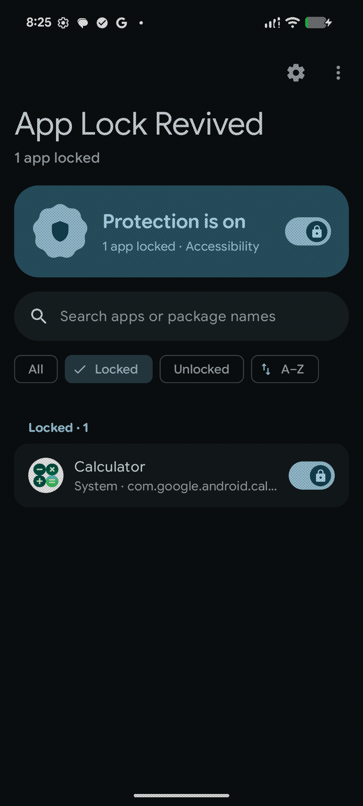
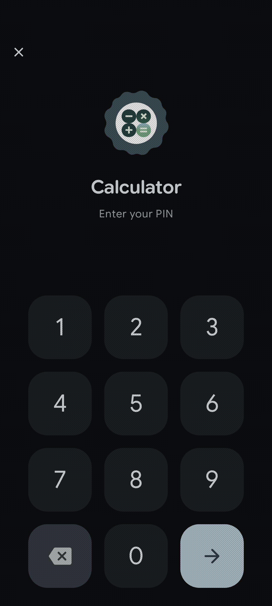
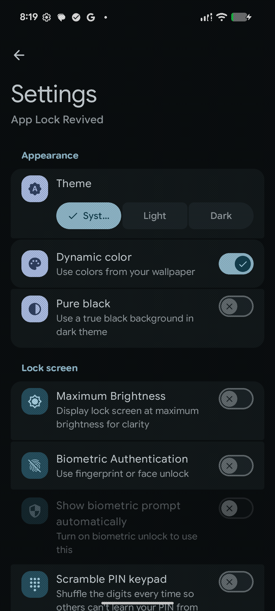
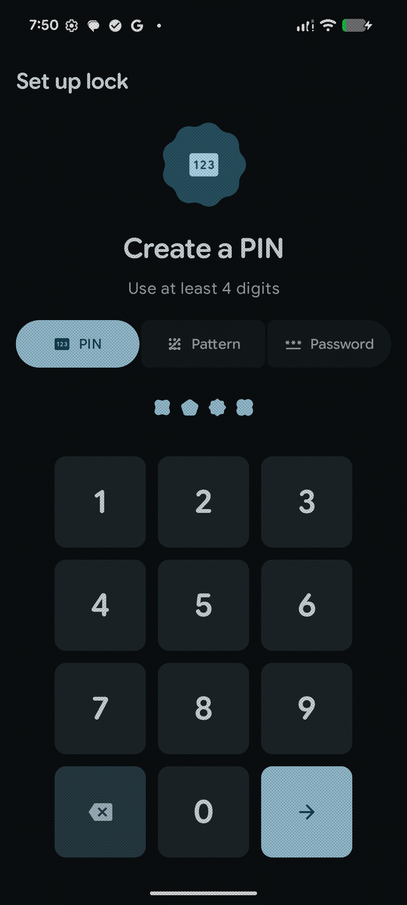
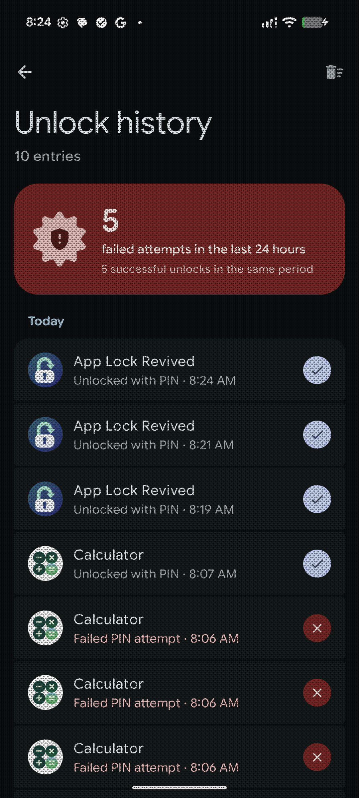
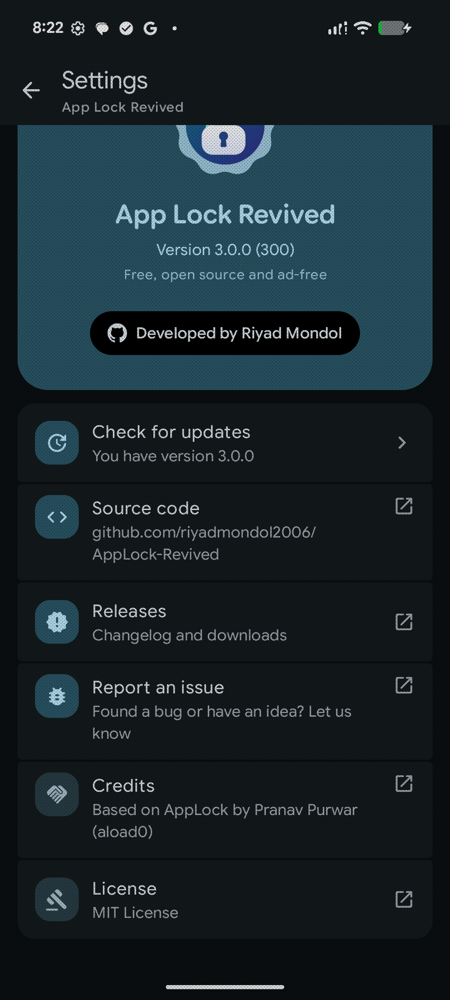

<div align="center">
  
</div>

<h1 align="center">App Lock Revived</h1>
<p align="center"><b>Open-source Android app locker, rebuilt with Material 3 Expressive</b></p>
<p align="center">A fork of <a href="https://github.com/aload0/AppLock">aload0/AppLock</a> by Pranav Purwar</p>

<p align="center">
  <a href="https://opensource.org/licenses/MIT">
    
  </a>
  <a href="https://github.com/riyadmondol2006/AppLock-Revived/releases/latest">
    
  </a>
  <a href="https://github.com/riyadmondol2006/AppLock-Revived/actions/workflows/android.yml">
    
  </a>
  
</p>

<p align="center">
  
  
  
</p>
<p align="center">
  
  
  
</p>

---

## About

App Lock Revived is a maintained fork of [AppLock by Pranav Purwar (aload0)](https://github.com/aload0/AppLock).
It locks any app behind a PIN, pattern, password or biometrics, with no root, no ads and no tracking.
Version 3.0 is a full redesign in Google's Material 3 Expressive style, plus security hardening,
a batch of bug fixes for long-standing upstream issues, and features users kept asking for.

Package name: `dev.riyadm.applock`. It installs alongside the original app.

## Features

**Locking**
- Lock any app with PIN, pattern or alphanumeric password
- Fingerprint / face unlock, with an optional automatic biometric prompt
- Three detection methods: Accessibility service, Usage stats, or Shizuku
- Unlock duration: re-lock immediately, after a few minutes, or when the screen turns off
- Lock newly installed apps automatically
- "Lock all now" Quick Settings tile
- Anti-uninstall protection (device admin)
- Trigger exclusions (apps that never trigger a lock, such as keyboards)

**Security**
- Brute-force protection: input is blocked after repeated wrong attempts, and the cooldown doubles each time
- Scrambled PIN keypad option against shoulder-surfing
- Screenshots and screen recording blocked on lock screens (`FLAG_SECURE`)
- Credentials hashed with PBKDF2-HMAC-SHA256; patterns are no longer stored in plain text
- On-device unlock history showing which app, when, which method, and success or failure

**Design**
- Material 3 Expressive throughout: flexible app bars, segmented lists, button groups, shape morphing, wavy progress
- Google Sans Flex variable typography
- Spring-based motion, predictive back, haptics (can be turned off)
- Light / dark / system theme, dynamic color, and pure black (AMOLED) mode
- Adaptive launcher icon, including Android 13+ themed icon

**Convenience**
- Backup and restore of locked apps and settings to a JSON file (your PIN/pattern/password is never exported)
- In-app update notice when a new release is published on GitHub
- Search, filters (locked / unlocked / system), sorting and multi-select on the app list

## What's new in 3.0

- **New UI:** every screen rebuilt with Material 3 Expressive (Compose Material3 1.5).
- **Bypass fixes from upstream issues:**
  - Cancelling the biometric prompt left apps unlocked (#228, #245, #220, #138)
  - Back + close revealed the app (#233)
  - Rapid recents switching (#190)
  - Multi-window and floating windows (#108, #61)
  - Notification-triggered locks (#150, #163)
  - Locked apps briefly visible when returning from recents
- **Reliability fixes:**
  - Crashes that disabled the accessibility service after reboot (#227, #250)
  - Service silently stopping (#178, #194)
  - Overlay re-triggering (#80)
  - Shizuku crashes (#184)
  - Prevent-uninstall lockout (#213)
  - Old passwords not accepted after updating (#215)
- **Security hardening:** PBKDF2 hashing, hashed patterns, brute-force lockout, `FLAG_SECURE`. Android
  auto-backup is disabled so credential hashes never leave the device.
- **Platform and tooling:** Android SDK 37.2, AGP 9.4, Gradle 9.8, Kotlin 2.4, Compose 1.13.

## Download

Get the latest signed APK from [GitHub Releases](https://github.com/riyadmondol2006/AppLock-Revived/releases/latest).
The app checks for new releases on its own and offers the update in a dialog. You can turn this off in
**Settings → Updates**.

> [!NOTE]
> Android 13+ blocks Accessibility for sideloaded apps by default. If the toggle is greyed out, open
> **App info → ⋮ → Allow restricted settings**, then enable the service. The app walks you through this
> during setup.

> [!CAUTION]
> Google Play Protect may warn about apps that use the overlay permission. App Lock Revived needs it to draw the
> lock screen. You can review the source code here.

## Privacy

- Everything stays on your device. There are no analytics, ads, trackers or accounts.
- The only network request is the optional update check, which reads the public
  [GitHub releases API](https://api.github.com/repos/riyadmondol2006/AppLock-Revived/releases/latest). Nothing about
  you or your apps is sent. Disable it in **Settings → Updates** and the app never goes online.
- Backups contain the list of locked apps and settings only, never your PIN, pattern or password.

## Building

Requirements: JDK 21 and the Android SDK with platform 37.2.

```bash
git clone https://github.com/riyadmondol2006/AppLock-Revived.git
cd AppLock-Revived
./gradlew assembleDebug        # app/build/outputs/apk/debug
./gradlew assembleRelease      # signed with the debug key unless a release key is configured
```

To sign release builds locally, create an untracked `keystore.properties` in the project root:

```properties
storeFile=/path/to/release.jks
storePassword=...
keyAlias=...
keyPassword=...
```

## Continuous integration and releases

[`.github/workflows/android.yml`](.github/workflows/android.yml) builds every push and pull request.
On pushes to `master` it also builds a **signed release APK**. When `versionName` in `app/build.gradle.kts`
changes, it publishes a GitHub Release tagged `v<versionName>` with the APK attached. The release notes come
from `fastlane/metadata/android/en-US/changelogs/<versionCode>.txt` when that file exists.

Add these repository secrets (**Settings → Secrets and variables → Actions**):

| Secret | Value |
|---|---|
| `SIGNING_KEYSTORE_BASE64` | Your keystore, base64-encoded: `base64 -w0 release.jks` |
| `SIGNING_KEYSTORE_PASSWORD` | Keystore password |
| `SIGNING_KEY_ALIAS` | Key alias |
| `SIGNING_KEY_PASSWORD` | Key password |

To ship an update, bump `versionCode` and `versionName`, add a changelog file, and push to `master`.

## Use cases

- Shared devices and kids using your phone
- Parental controls
- Protecting work, banking, gallery and chat apps
- General privacy

## Credits

- Original app: [AppLock](https://github.com/aload0/AppLock) by **Pranav Purwar (aload0)** and contributors
- Revived and maintained by **[Riyad M](https://github.com/riyadmondol2006)**
- [Shizuku](https://github.com/RikkaApps/Shizuku), [HiddenApiBypass](https://github.com/LSPosed/AndroidHiddenApiBypass)
- [Google Sans Flex](https://github.com/googlefonts/googlesans-flex), licensed under the SIL Open Font License 1.1 ([art/GoogleSansFlex-OFL.txt](art/GoogleSansFlex-OFL.txt))

Found a bug or have an idea? [Open an issue](https://github.com/riyadmondol2006/AppLock-Revived/issues).

## License

MIT. See [LICENSE](LICENSE). Original work © 2023-2025 Pranav Purwar; modifications © 2026 Riyad M.
